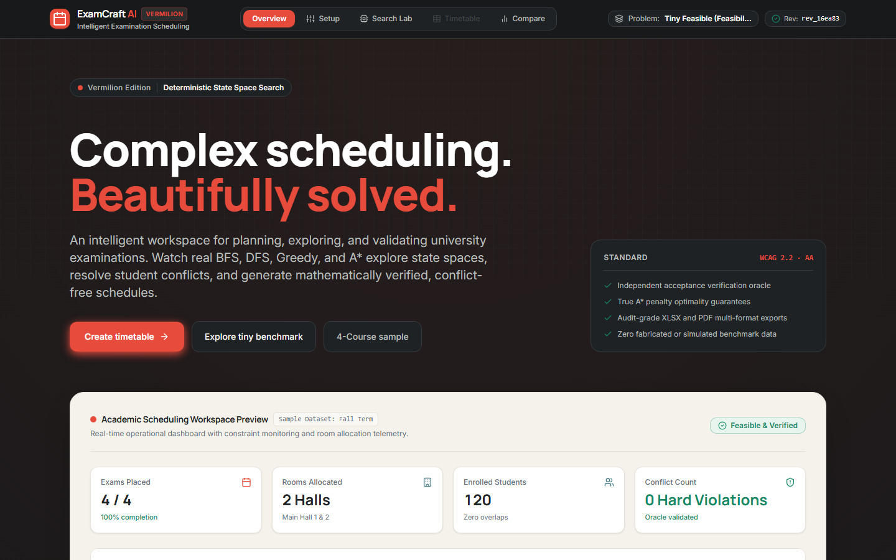
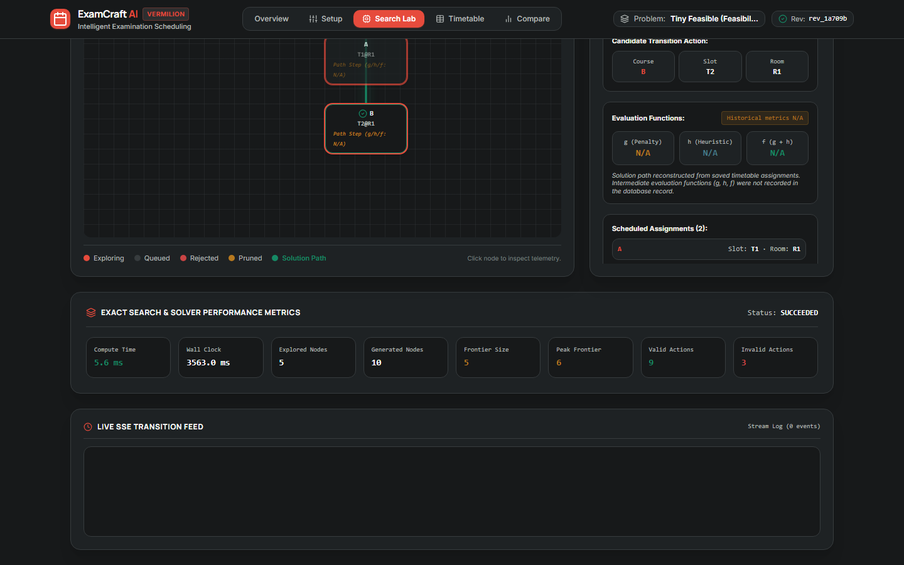
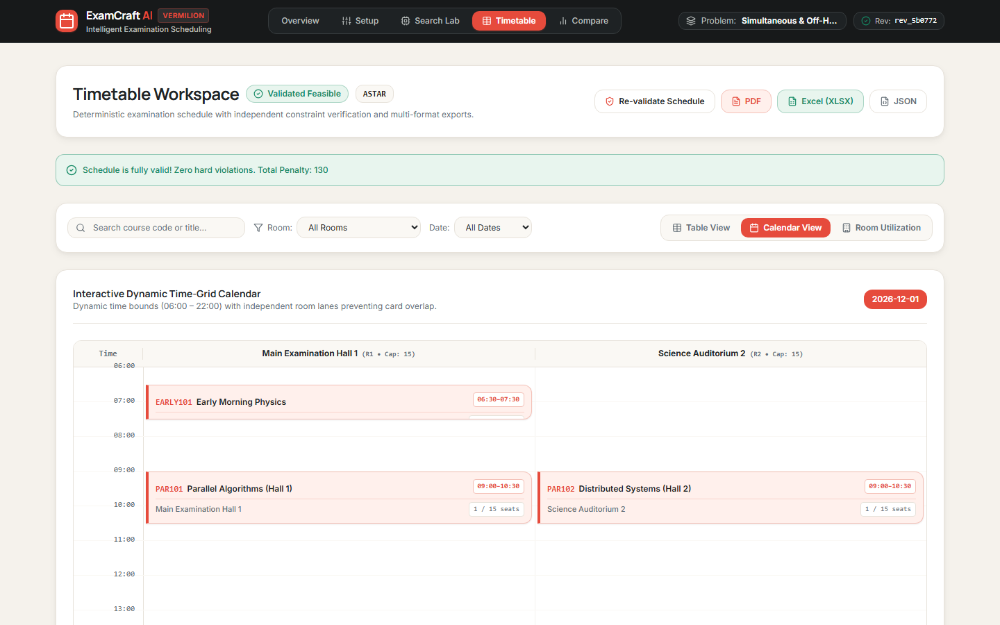
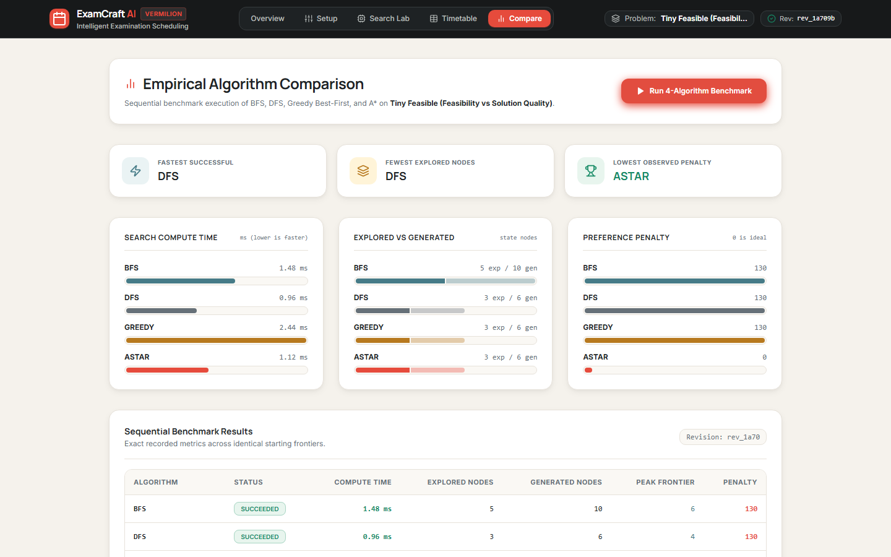
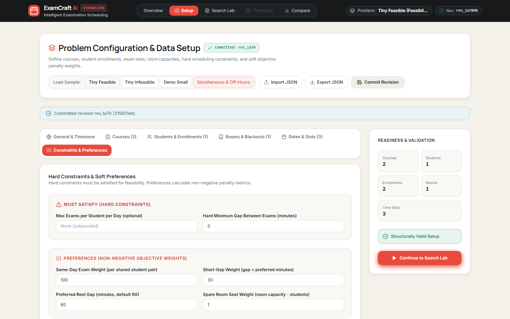

# ExamCraft AI

**Deterministic State-Space Search & Visual Scheduling Laboratory for University Examinations**

[](https://www.python.org/)
[](https://fastapi.tiangolo.com/)
[](https://react.dev/)
[](https://www.typescriptlang.org/)
[](https://tailwindcss.com/)
[](https://vitejs.dev/)
[](LICENSE)

---

ExamCraft AI is a university examination scheduling platform powered by classical state-space search algorithms. Rather than relying on black-box solvers or probabilistic heuristics, it formulates timetable generation as an exact Constraint Satisfaction Problem (CSP) and implements **Breadth-First Search (BFS)**, **Depth-First Search (DFS)**, **Greedy Best-First Search**, and **$A^*$ Search** over an identical deterministic problem model.

The platform pairs a scientific dark-mode Search Laboratory with an editorial Warm Paper workspace, featuring live Server-Sent Events (SSE) streaming, atomic step-by-step execution controls, an independent verification oracle, and native PDF/XLSX export engines.

---

## Visual Tour

<p align="center">
  
</p>

### Key Workspaces

| Search Laboratory (A* Solution Path) | Timetable Calendar (Dynamic Room Lanes) |
|:---:|:---:|
|  |  |

| Empirical Algorithm Comparison | Guided Problem Setup & Revisions |
|:---:|:---:|
|  |  |

---

## Architectural Highlights

### 1. Pure Deterministic Search Engine
- **Unified Problem Model**: BFS, DFS, Greedy, and A* operate over the exact same state graph, deterministic course ordering (highest conflict-graph degree, enrollment count, course ID), and candidate slot/room domains.
- **Provably Admissible Heuristic ($h(n) \le h^*(n)$)**: Calculates the relaxed lower bound of pending student short-gap and same-day penalties without overestimating, guaranteeing optimal minimum-penalty schedules with $A^*$.
- **Forward Pruning**: Detects empty static domains ($D_i(S) = \emptyset$) on unassigned courses and prunes dead-end branches immediately before state expansion.
- **Truthful Outcomes**: Strictly differentiates between `OPTIMAL_SOLUTION_FOUND`, `FEASIBLE_SOLUTION_FOUND`, `LIMIT_REACHED` (budget exhaustion), and `INFEASIBLE` (proven unsolvable).

### 2. Interactive Execution Controls
- **Atomic Engine Pacing**: Pause freezes solver execution at clean transition boundaries. Single-step mode advances exactly one state expansion for classroom teaching and algorithmic demonstration.
- **Decoupled Pacing vs. Benchmarks**: Visual animation pacing (50ms–500ms) is completely decoupled from performance benchmarks, which use monotonic processor clocks (`time.perf_counter()`) for nanosecond-grade timing honesty.
- **Crash Recovery & F5 Truthfulness**: Active runs survive browser refreshes. Reconstructed solution paths accurately display `N/A` for historical evaluations rather than synthesizing fabricated zero metrics.

### 3. Dynamic Timetable Operations
- **Unbounded Dynamic Calendar**: Replaces arbitrary 9-to-5 grids with dynamic hour bounds (e.g. 06:00 to 22:00) derived from actual scheduled exam times.
- **Simultaneous Room Lanes**: Multiple exams occurring in the same timeslot render side-by-side in independent room columns with zero card collision.
- **Native Document Exporters**:
  - **Excel (`.xlsx`)**: Genuine `datetime.date` (`yyyy-mm-dd`) and `datetime.time` (`hh:mm`) cells via `openpyxl` with formula injection sanitization.
  - **PDF (`.pdf`)**: Paginated vector tables with ReportLab, complete with repeat table headers and overflow wrapping.

### 4. Independent Acceptance Oracle
- Completely decoupled verification suite (`verification/oracle.py`) containing zero solver imports.
- Evaluates complete schedules against 7 hard constraints and independently recomputes penalty functions before any timetable is certified.

---

## Repository Structure

```text
.
├── apps/
│   ├── api/                           # FastAPI backend application
│   │   ├── app/
│   │   │   ├── domain/                # Normalized problem models & conflict graphs
│   │   │   ├── search/                # BFS, DFS, Greedy, A* solvers & heuristic definitions
│   │   │   ├── validation/            # Schedule validator & constraint verification
│   │   │   ├── storage/               # SQLite persistence (revisions, runs, benchmarks)
│   │   │   ├── exports/               # ReportLab PDF & openpyxl XLSX generators
│   │   │   ├── runs/                  # Thread worker manager & SSE event dispatcher
│   │   │   └── main.py                # API router & static asset mounting
│   ├── web/                           # React + TypeScript frontend
│   │   ├── src/
│   │   │   ├── components/            # Editorial Navbar & layout containers
│   │   │   ├── features/
│   │   │   │   ├── overview/          # Hero view, KPI metrics, sample loaders
│   │   │   │   ├── setup/             # Problem configuration workspace & revision commits
│   │   │   │   ├── search/            # Deep Graphite Search Lab, SVG tree graph, inspector
│   │   │   │   ├── timetable/         # Warm Paper dashboard (Table, Dynamic Calendar, Room views)
│   │   │   │   └── comparison/        # Sequential 4-algorithm benchmark runner
│   │   │   ├── api/                   # Typed API client & SSE subscriber
│   │   │   └── App.tsx                # Central state manager & dirty-state tracking
│   │   ├── tailwind.config.js         # Vermilion Edition design token palette
│   │   └── vite.config.ts             # Vite build pipeline
├── docs/                              # Formal specification, contracts, and screenshots
├── fixtures/                          # Standard problem fixtures (tiny_feasible, demo_small, etc.)
├── tests/                             # Integration tests & Playwright browser verification
├── verification/                      # Independent acceptance oracle & test runner
├── vercel.json                        # Vercel deployment configuration
└── requirements.txt                   # Pinned Python dependencies
```

---

## Quickstart & Local Setup

### Prerequisites
- **Python**: 3.10 or higher
- **Node.js**: 18.0 or higher
- **Git**

### 1. Clone & Set Up the Python Environment

```bash
git clone https://github.com/<your-username>/examcraft-ai.git
cd examcraft-ai

# Create virtual environment
python -m venv .venv

# Activate virtual environment
# Windows (PowerShell):
.\.venv\Scripts\Activate.ps1
# macOS / Linux:
source .venv/bin/activate

# Install dependencies
pip install -r requirements.txt
```

### 2. Build the Frontend Assets

```bash
cd apps/web
npm install
npm run build
cd ../..
```

### 3. Launch the Application

```bash
# Windows / macOS / Linux (from project root):
python -m uvicorn app.main:app --app-dir apps/api --host 127.0.0.1 --port 8000
```

Open your browser at **[http://127.0.0.1:8000/](http://127.0.0.1:8000/)**.

*(Optional: For frontend hot-reloading during development, run `npm run dev` inside `apps/web` on port 5173).*

---

## Verification & Automated Test Suites

The codebase includes comprehensive test suites spanning unit verification, engine regressions, and automated browser end-to-end journeys:

```bash
# 1. Independent Acceptance Oracle Tests (15 tests)
python verification/test_oracle.py

# 2. Engine Regression Suite (7 tests)
python ExamCraft_AI_Repair_Pack/tests/test_engine_regressions.py

# 3. Excel Native Date/Time Cell Type Inspection
python tests/verify_xlsx_types.py docs/sample_exports/sample_schedule.xlsx

# 4. End-to-End Playwright Browser Verification (8 journeys)
node tests/browser_verification.js
```

---

## Deploying to Vercel & Cloud

ExamCraft AI is structured for flexible deployment:

### Frontend on Vercel
1. Push this repository to your GitHub account.
2. In the [Vercel Dashboard](https://vercel.com/), click **Add New Project** and import the repository.
3. Configure the project:
   - **Framework Preset**: `Vite`
   - **Root Directory**: `apps/web` (or leave as root with the included root `vercel.json`)
   - **Build Command**: `npm run build`
   - **Output Directory**: `dist`
4. Set an environment variable (optional, if your backend is hosted separately):
   - `VITE_API_URL`: `https://your-backend-api.onrender.com`
5. Click **Deploy**.

### Backend on Render / Railway / Fly.io
The backend requires a persistent environment to maintain in-memory search workers, SQLite revisions, and SSE event streaming:
- **Build Command**: `pip install -r requirements.txt`
- **Start Command**: `uvicorn app.main:app --app-dir apps/api --host 0.0.0.0 --port $PORT`

---

## Technical Specifications

| Parameter | Specification |
|---|---|
| **Algorithms** | BFS, DFS, Greedy Best-First ($f = h$), $A^*$ ($f = g + h$) |
| **Heuristic Guarantee** | Admissible ($h \le h^*$) and Monotonically Consistent |
| **Hard Constraints** | Room Capacity, Exclusive Occupancy, Student Conflicts, Room Blackouts, Allowed Slots, Max Exams/Day, Min Gap Separation |
| **Objective Penalties** | Same-day exam pairs, Short gap intervals, Unused room seat capacity |
| **Streaming Protocol** | W3C Server-Sent Events (SSE) with sequence deduplication |
| **UI Design System** | Vermilion Edition: Deep Graphite (`#17191A`), Warm Paper (`#F5F2EC`), Vermilion Accent (`#E64B3C`) |
| **Typography** | Manrope (Display), Inter (Interface & Tabular Numerals) |

---

## License

This project is licensed under the [MIT License](LICENSE).
